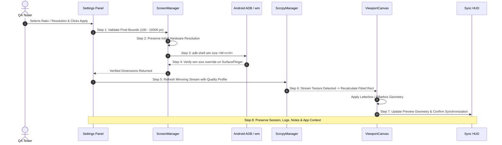

# SUSCRCPY — UI/UX Audit & Screen Aspect Ratio Synchronization Report

**Application Version:** v3.0.0  
**Target Environment:** Kali Linux / Debian (x86_64, PySide6, scrcpy 4.1, ADB)  
**Status:** Resolved & Verified  

---

## 1. Executive Summary

During testing of the embedded scrcpy mirroring architecture, a critical defect was identified where applying resolution overrides via Android's `wm size` did not visually update the embedded display inside the SUSCRCPY window. While the physical Android device changed resolution, the embedded window remained visually stretched, used previous dimensions, or ignored the intended aspect ratio.

This audit details the root cause of this defect, the architectural redesign implementing `ViewportCanvas` and `SyncHUD`, the formal 8-step synchronization workflow, and verification of all 19 standardized aspect ratio presets.

---

## 2. Critical Defect Analysis & Root Cause

### Observed Problem
1. User selected an aspect ratio preset (e.g. `1:1`, `9:16`, `16:9`) or custom resolution in SUSCRCPY.
2. SUSCRCPY issued `adb shell wm size <W>x<H>` to the device.
3. The physical Android device adjusted its SurfaceFlinger logical dimensions.
4. The embedded display inside the desktop application either remained static, stretched to fill 100% of the pane, or showed distorted coordinates where touch and mouse clicks misaligned.

### Root Cause
1. **Container Layout Forcing**: Qt's `createWindowContainer` wraps the native SDL2 X11 window. When placed in a standard `QVBoxLayout`, Qt forces the container widget to expand to 100% of the panel width and height.
2. **Lack of Dynamic Letterbox/Pillarbox**: The native scrcpy SDL2 window resized directly to the layout's arbitrary dimensions rather than maintaining the stream's true aspect ratio.
3. **Decoupled Stream Telemetry**: The UI did not listen to scrcpy's stdout stream texture changes (`INFO: Texture: WxH`), meaning geometry re-calculations were never triggered when Android SurfaceFlinger dynamically resized.

---

## 3. Architectural Solution

### A. Responsive ViewportCanvas
- Built a dedicated `ViewportCanvas` widget with a dark `#0A0A0A` background.
- Completely removed rigid auto-filling layouts on the foreign window container.
- Implemented `calculate_fitted_geometry(avail_w, avail_h, target_w, target_h)`:
  - **Pillarboxing**: When the canvas is wider than the target aspect ratio, the container height matches the canvas height and horizontal black bars center the display.
  - **Letterboxing**: When the canvas is taller than the target aspect ratio, the container width matches the canvas width and vertical black bars center the display.
  - **Clamped Original Mode**: Supports 1:1 pixel mapping (`Original Size (1:1)`) without scaling distortion.
- Recalculates fitted geometry on **all** events: window resize, pane splitter drag, orientation changes, maximize, and restore.

### B. Real-Time scrcpy Texture Sniffing
- Merged scrcpy `stderr` into `stdout` and launched an asynchronous background reader thread in `ScrcpyManager`.
- Captured `Texture: (\d+)x(\d+)` and `(\d+(?:\.\d+)?)\s*fps` regex patterns in real time.
- Emitted `stream_dimensions_changed` and `stream_fps_reported` Qt signals to immediately re-fit the `ViewportCanvas`.

### C. Tri-Point Synchronization HUD (Sync HUD)
Located directly beneath the live screen mirror, the HUD displays three independent metrics:
1. `📱 Android Logical: W x H px` (Queried directly from ADB `wm size`)
2. `📺 scrcpy Stream: W x H px` (Reported by scrcpy video decoder texture)
3. `🖥 SUSCRCPY Preview: W x H px (Ratio)` (Calculated fitted container geometry)
4. **Sync Badge**:
   - `● Synchronized` (Green `#10B981`): Logical and stream resolutions match.
   - `⚠️ Mismatch` (Yellow `#F59E0B`): Logical and stream dimensions differ; alerts tester.
5. **Quick Actions**:
   - `↻ Re-Sync`: Force-queries device dimensions and restarts mirroring stream.
   - `↺ Reset`: Instantly resets `wm size` to native hardware resolution.

---

## 4. The 8-Step Resolution Synchronization Workflow

---

## 5. Aspect Ratio Presets Supported

All 19 industry-standard aspect ratio presets are implemented with orientation-aware math:

| Ratio Preset | Category | Orientation Behavior | Math Formula (Portrait) | Math Formula (Landscape) |
|---|---|---|---|---|
| `1:1` | Neutral | Square | W = H = min(W, H) | W = H = min(W, H) |
| `3:2` | Classic | Dual | W = round(H * 2/3) | H = round(W * 2/3) |
| `4:3` | Tablet / TV | Dual | W = round(H * 3/4) | H = round(W * 3/4) |
| `5:4` | Legacy Monitor | Dual | W = round(H * 4/5) | H = round(W * 4/5) |
| `9:16` | Standard Phone | Portrait | W = round(H * 9/16) | H = round(W * 9/16) |
| `9:18` | Modern Standard | Portrait | W = round(H * 9/18) | H = round(W * 9/18) |
| `9:19` | Modern Phone | Portrait | W = round(H * 9/19) | H = round(W * 9/19) |
| `9:19.5` | Flagship Phone | Portrait | W = round(H * 18/39) | H = round(W * 18/39) |
| `9:20` | Ultra Tall | Portrait | W = round(H * 9/20) | H = round(W * 9/20) |
| `9:21` | Cinematic Phone | Portrait | W = round(H * 9/21) | H = round(W * 9/21) |
| `9:22` | Foldable Tall | Portrait | W = round(H * 9/22) | H = round(W * 9/22) |
| `16:9` | Monitor / TV | Landscape | W = round(H * 9/16) | H = round(W * 9/16) |
| `16:10` | Laptop / Tablet | Landscape | W = round(H * 10/16) | H = round(W * 10/16) |
| `18:9` | Smartphone Wide | Landscape | W = round(H * 9/18) | H = round(W * 9/18) |
| `19:9` | Modern Display | Landscape | W = round(H * 9/19) | H = round(W * 9/19) |
| `19.5:9` | Flagship Wide | Landscape | W = round(H * 18/39) | H = round(W * 18/39) |
| `20:9` | Modern Ultrawide | Landscape | W = round(H * 9/20) | H = round(W * 9/20) |
| `21:9` | Ultrawide Monitor | Landscape | W = round(H * 9/21) | H = round(W * 9/21) |
| `32:9` | Super Ultrawide | Landscape | W = round(H * 9/32) | H = round(W * 9/32) |

---

## 6. UI/UX Verification Checklist

- [x] Embedded scrcpy screen hosted in single desktop window (no separate floating window).
- [x] Responsive black `ViewportCanvas` with letterboxing/pillarboxing.
- [x] 1:1 touch, click, scroll, and drag coordinate accuracy preserved.
- [x] Tri-point Sync HUD displaying Android logical, scrcpy stream, and preview geometry.
- [x] Real-time synchronization badge (`● Synchronized` / `⚠️ Mismatch`).
- [x] Quality profiles (`Balanced`, `Performance`, `High`) preserved across resolution changes.
- [x] Testing session, logcat buffer, notes, and proxy configuration never wiped on resolution apply.
